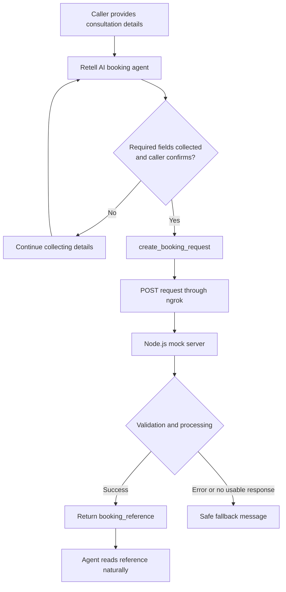

<div align="center">


# NovaNest Custom Booking Function

### Consent-based booking requests with Retell AI and Node.js

A practical assessment project demonstrating custom function calling, request validation, idempotency, and caller-friendly error handling.

[](https://nodejs.org/)


[](https://www.loom.com/share/a227ccdad81945b5abc511efccc75fcd)
[](https://github.com/shaikshahid777/novanest-custom-booking-function)

[](docs/API_CONTRACT.md)
[](docs/FAQ.md)
[](docs/TEST_RESULTS.md)

</div>

---

## Contents

- [Overview](#overview)
- [Features](#features)
- [Architecture](#architecture)
- [Function Configuration](#function-configuration)
- [Function Parameters](#function-parameters)
- [Endpoint Behaviour](#endpoint-behaviour)
- [Quick Start](#quick-start)
- [Demo Video](#demo-video)
- [Evidence Screenshots](#evidence-screenshots)
- [Test Status](#test-status)
- [Limitations](#limitations)
- [Possible Enhancements](#possible-enhancements)
- [Repository Structure](#repository-structure)
- [Author](#author)

## Overview

**Assessment:** Retell AI Topic 7, Lesson 5 — *Custom Function Calling for Real Business Actions*.

This project extends the NovaNest Consultation Booking Agent with one custom function, `create_booking_request`. After the caller provides the required details and explicitly answers yes to “Shall I go ahead and submit this booking request now?”, the agent sends a POST request to a Node.js mock endpoint exposed through ngrok.

The endpoint validates the request and returns a simulated booking reference. The agent reads the reference naturally. If submission fails or no usable response is received, the agent uses a safe fallback message and does not read technical error codes to the caller.

> **Scope:** This is a mock booking-request workflow. It does not check live availability or create a real calendar appointment.

## Features

- **Explicit consent:** The function should run only after required details are collected and the caller confirms submission.
- **Structured arguments:** JSON-schema parameters define caller details, service type, and preferred consultation windows.
- **Input validation:** Missing required fields and invalid phone formats return structured errors.
- **Simulated booking reference:** Successful requests return a `booking_reference`.
- **Idempotency:** The same payload returns the same reference while the in-memory store remains available.
- **Safe failure response:** The agent uses a caller-friendly fallback rather than exposing internal errors.
- **Endpoint test modes:** `?mode=503` simulates a server failure; `?mode=delay` delays the response.
- **Zero third-party Node.js dependencies:** The mock server uses built-in Node.js modules.

## Architecture



### Failure-handling sequence

1. The agent collects and confirms the required booking details.
2. The agent waits for explicit consent before calling the function.
3. The endpoint validates the payload and processes the mock request.
4. On success, the agent communicates the returned reference naturally.
5. On error or no usable response, the agent uses the configured fallback and does not read error codes or field names.

Fallback message:

> I wasn't able to submit the request right now, but your details have been noted and our team will follow up shortly to confirm your slot.

## Function Configuration

| Setting | Configured value |
|---|---|
| Function name | `create_booking_request` |
| HTTP method | `POST` |
| Endpoint path | `/create_booking_request` |
| Args Only | ON |
| Timeout | 10 seconds |
| Maximum retries | 2 |
| Header | `ngrok-skip-browser-warning: true` |
| Talk While Waiting | ON |
| Waiting sentence | “Let me go ahead and submit that booking request for you now.” |
| Talk After Action Completed | ON |

The ngrok URL is a free-tunnel address and can change. Use the current forwarding URL when configuring Retell.

## Function Parameters

| Parameter | Expected value | Requirement |
|---|---|---|
| `caller_first_name` | Non-empty string | Required |
| `caller_last_name` | Non-empty string | Required |
| `caller_phone` | Exactly 10 digits | Required |
| `caller_email` | Email-like string with a domain | Required |
| `service_type` | Buyer Consultation / Seller Consultation / Investment Review | Required |
| `preferred_window_1` | Required (non-empty). The agent prompt instructs the agent to include the timezone; the endpoint does not validate it. | Required |
| `preferred_window_2` | Preferred time window | Optional |
| `preferred_window_3` | Preferred time window | Optional |

## Endpoint Behaviour

| Scenario | Expected behaviour |
|---|---|
| Missing required field | HTTP `400`, code `MISSING_FIELD` |
| Invalid phone format | HTTP `400`, code `INVALID_FORMAT` |
| Valid request | HTTP `200` with a `booking_reference` |
| Same payload submitted again | Same reference from the in-memory idempotency store |
| `?mode=503` | Simulated HTTP 503 service failure |
| `?mode=delay` | Response delayed by 15 seconds to exercise timeout handling |

The reference is simulated by the mock server. It is not a real appointment confirmation.

## Quick Start

### Prerequisites

- Node.js installed
- PowerShell on Windows
- ngrok installed and configured
- Access to the Retell AI agent configuration

### 1. Start the mock server

From the repository root, open PowerShell and run:

```powershell
npm start
```

Keep this window open. It prints incoming request and booking logs.

### 2. Start ngrok

Open a second PowerShell window:

```powershell
ngrok http 3000
```

Copy the HTTPS forwarding URL shown by ngrok and append `/create_booking_request`. Update the Retell function URL if the forwarding address differs from the configured address.

### 3. Check the local server

Open a third PowerShell window and run:

```powershell
Invoke-RestMethod -Method Get -Uri "http://localhost:3000/health"
```

The server defines `GET /health` and should return a small JSON status response.

### 4. Run endpoint tests

The repository includes a shell-based test script:

```bash
npm test
```

**Windows note:** `npm test` runs a Bash script and therefore requires Git Bash (with curl available). In PowerShell, you can test the endpoint directly with `Invoke-RestMethod`. The independently documented test statuses are listed in [docs/TEST_RESULTS.md](docs/TEST_RESULTS.md).

### 5. Configure Retell

1. Open the NovaNest Consultation Booking Agent.
2. Configure `create_booking_request` using [config/function_config.md](config/function_config.md).
3. Use [config/create_booking_request.schema.json](config/create_booking_request.schema.json) for the function schema.
4. Apply the prompt rules in [config/prompt_additions.md](config/prompt_additions.md).
5. Test with the required details and wait for explicit caller confirmation before submitting.

## Demo Video

[](https://www.loom.com/share/a227ccdad81945b5abc511efccc75fcd)

The video demonstrates the recorded workflow. See the status table below to distinguish scenarios covered in the video from independently verified passes and tests that were not run.

## Evidence Screenshots

The following screenshots use the exact filenames stored in the repository.


*Function configuration overview.*


*Args Only and Talk While Waiting settings.*


*Configured function parameter list.*


*Prompt instructions for asking permission and submitting the request.*


*Rules for function calls and handling the result.*


*PowerShell evidence for the endpoint tests.*


*ngrok request activity captured during the workflow.*

### Happy-path server log

[View the captured server log](screenshots/server-log-happy-path.txt)

The log records the incoming top-level payload, the generated mock booking reference, and the endpoint-level missing-phone, invalid-phone, and idempotency results.

## Test Status

Statuses below are intentionally conservative. “Covered in demo video” does not mean that a separate test result was independently verified.

| Test ID | Scenario | Status | Evidence |
|---|---|---|---|
| TC-001 | Happy path | Covered in demo video | [Loom demo](https://www.loom.com/share/a227ccdad81945b5abc511efccc75fcd) |
| TC-002 | Parameters at top level | Pass (server log) | [Happy-path server log](screenshots/server-log-happy-path.txt) |
| TC-003 | Early trigger prevention | Not run | No verified result |
| TC-004 | Reference read naturally | Covered in demo video | [Loom demo](https://www.loom.com/share/a227ccdad81945b5abc511efccc75fcd) |
| TC-005 | 503 handling | Not run | No verified result |
| TC-006 | Timeout and retry handling | Not run | No verified result |
| TC-007 | Missing phone | Pass (HTTP 400, MISSING_FIELD) | [PowerShell endpoint test screenshot](screenshots/Screenshot%202026-10-10%20214519.png) |
| TC-008 | Invalid phone | Pass (HTTP 400, INVALID_FORMAT) | [PowerShell endpoint test screenshot](screenshots/Screenshot%202026-10-10%20214519.png) |
| TC-009 | Idempotency | Pass (same reference returned twice) | [PowerShell endpoint test screenshot](screenshots/Screenshot%202026-10-10%20214519.png) |
| TC-010 | No raw error data spoken to the caller | Not run | No verified result |

Failure handling is verified at endpoint level only (`?mode=503` and `?mode=delay` exist in the server); no Retell failure test was run.

See [docs/TEST_RESULTS.md](docs/TEST_RESULTS.md) for the standalone results record.

## Limitations

- **In-memory idempotency:** Stored references are lost when the server restarts.
- **No endpoint authentication:** The mock endpoint does not authenticate incoming requests.
- **No real CRM/calendar integration:** The endpoint does not check live availability or create real appointments.
- **Simulated booking reference:** A returned reference identifies a mock request, not a confirmed reservation.
- **ngrok free URL can change:** Retell's configured URL may need updating when the tunnel changes.

## Possible Enhancements

The following are planned and **not implemented**:

- Add endpoint authentication.
- Persist requests and idempotency keys in a database.
- Integrate a real CRM or calendar API.
- Add SMS confirmation.

## Repository Structure

```text
.
├── server/
│   └── server.js
├── config/
│   ├── function_config.md
│   ├── create_booking_request.schema.json
│   └── prompt_additions.md
├── docs/
│   ├── API_CONTRACT.md
│   ├── FAQ.md
│   ├── TEST_RESULTS.md
│   └── DEMO_SCRIPT.md
├── tests/
│   └── run_tests.sh
├── screenshots/
│   ├── Screenshot 2026-10-10 212813.png
│   ├── Screenshot 2026-10-10 214307.png
│   ├── Screenshot 2026-10-10 214519.png
│   ├── Screenshot 2026-10-11 072017.png
│   ├── Screenshot 2026-10-11 072158.png
│   ├── Screenshot 2026-10-11 072338.png
│   ├── Screenshot 2026-10-11 072400.png
│   └── server-log-happy-path.txt
└── package.json
```

## Author

**Shaik Mohammad Shaheed**  
GitHub: [@shaikshahid777](https://github.com/shaikshahid777)

Assessment: Retell AI Topic 7, Lesson 5 — Custom Function Calling for Real Business Actions.

<div align="center">

[Watch Demo on Loom](https://www.loom.com/share/a227ccdad81945b5abc511efccc75fcd)

</div>
